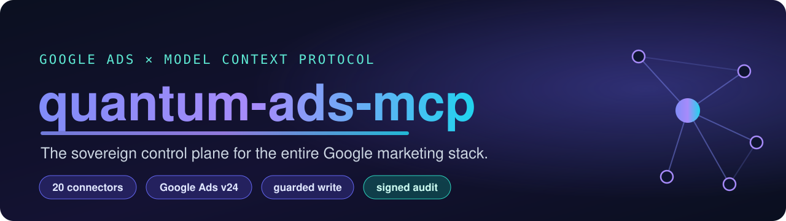
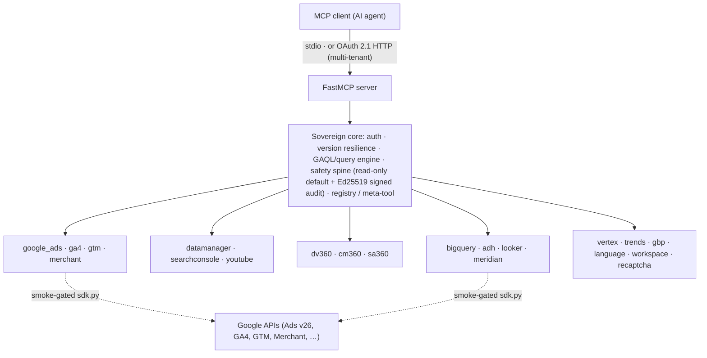

<!-- mcp-name: io.github.casius999/quantum-ads-mcp -->
<div align="center">



# quantum-ads-mcp

[](https://github.com/Casius999/quantum-ads-mcp/actions/workflows/ci.yml)
[](https://github.com/Casius999/quantum-ads-mcp/actions/workflows/codeql.yml)
[](https://scorecard.dev/viewer/?uri=github.com/Casius999/quantum-ads-mcp)
[](https://developers.google.com/google-ads/api/docs/release-notes)
[](https://www.python.org/)
[](https://modelcontextprotocol.io/)
[](CONNECTORS.md)
[](pyproject.toml)
[](pyproject.toml)
[](LICENSE)

**The most complete open Model Context Protocol control plane for the Google marketing stack** — 21 connectors, read + guarded write, Ed25519 signed audit, OAuth 2.1 multi-tenant.

[Architecture](#architecture) · [The 21 connectors](#the-21-connectors) · [Install](#install) · [Configure](#configure) · [Safety](#safety--honest-claims) · [Autonomy](#agent-autonomy-and-mcp-native-features) · [Observability](#observability) · [Roadmap](#roadmap)

</div>

A **sovereign Google marketing-agency control plane** over the Model Context Protocol: a shared
core (multi-tenant auth, version resilience, a GAQL/query engine, a safety spine with a signed
audit ledger) and **21 pluggable per-product connectors** spanning the entire Google marketing
stack. Built for an AI agent to operate that stack at full granularity, safely.

> **Status.** The full connector surface is built and tested at the logic layer: **read + guarded
> write across 21 products**, every tool exercised by mocked tests (no live SDK needed). The
> per-product **live SDK glue is isolated in `sdk.py` modules and smoke-gated** (verified against
> real APIs with your own credentials, not in CI — Google Ads API v26 included; see
> [docs/LIVE_VALIDATION_RESULTS.md](docs/LIVE_VALIDATION_RESULTS.md)). Served over **stdio** or
> **Streamable HTTP behind OAuth 2.1** (JWT bearer tokens, RFC 9728 metadata, per-tenant
> credentials and scopes), verified end to end against a real HTTP server. Read-only by default.
> Every "most X" claim here is meant to be verifiable.

## Contents

[Why](#why-this-exists) · [The 21 connectors](#the-21-connectors) · [Architecture](#architecture) · [Core](#core-shared-by-every-connector) · [Install](#install) · [Configure](#configure) · [Run](#run) · [Safety & honest claims](#safety--honest-claims) · [Roadmap](#roadmap)

## Architecture



## Why this exists

Surveying June 2026: Google's official MCP is read-only (3 tools); the best open write-capable
servers are pinned to sunsetting API versions, untested, single-product, or have no safety layer;
the capable commercial ones are closed and remote-only. **No open, self-hostable server is
simultaneously complete across the stack, write-capable, safe, tested, version-resilient, and
multi-product.** Quantum ADS fills that gap.

## The 21 connectors

| Domain | Connectors |
|--------|-----------|
| **Paid media** | Google Ads (v26), DV360, CM360, SA360 |
| **Measurement** | GA4 (Data + Admin), Data Manager API (Customer Match + conversions), Search Console |
| **Catalog / tagging** | Merchant API, Google Tag Manager (+ server-side, Consent Mode v2) |
| **Channels** | YouTube (Data + Analytics + Reporting), Business Profile, Trends |
| **Warehouse / BI / MMM** | BigQuery (cost-guarded), Ads Data Hub, Looker, Meridian (Bayesian MMM) |
| **Creative / ops** | Vertex AI (Gemini 3.8 / Gemini image / Veo 3.1, pure REST), free text-to-video (Wan 2.2 / LTX-Video on Hugging Face ZeroGPU, no billing), creative studio + campaign insights (anomalies, pacing, search-term mining, GA4 reconciliation; free OpenAI-compatible / SDXL / FLUX fallback when Vertex is unbilled), Cloud Translation + NL, Workspace (Sheets/Drive/Slides), reCAPTCHA Enterprise |

Full tool catalog, backend keys, and required SDK packages: **[CONNECTORS.md](CONNECTORS.md)**.

**Beyond the curated tools**, `google.api.call` runs any write method of 25 marketing Google
APIs (653 write methods, 1,180 in all), checked offline against each API's Discovery contract,
scope-checked, guarded, audited and reversible where the API allows — the way `ads.mutate`
covers every Google Ads resource.

## Core (shared by every connector)

- **Multi-tenant auth + secret store** — credentials load from env / secret manager and **never reach the LLM**.
- **Version resilience** — pinned **Google Ads API v26** from one `DEFAULT_API_VERSION`, official sunset table + guard (days-until-sunset), **offline GAQL field conformance** (every queried field resolved against the SDK protos of the pinned version), `ads.api.version_delta` (exact resources/services/enums added or removed between two versions), and **unknown-enum tolerance** for Google's monthly releases.
- **Query engine** — GAQL build / validate (single-FROM, no-`OR`, segment rules, 37-month cap) / stream / flatten, with quota token-buckets + exponential backoff. SA360 uses the same query shape.
- **Safety spine** — **read-only by default**; every mutation is guarded: `validate_only` preview → **two-step confirm token** → **Ed25519-signed, hash-chained audit ledger**, persisted across restarts and verifiable with `audit.status`. Consent-aware (Data Manager / Consent Mode v2) and cost-aware (BigQuery dry-run, $6.25/TiB).
- **Connector registry + meta-tool discovery** (`list_capabilities`, `describe_tool`) and **env-based connector selection** (`QUANTUM_ADS_CONNECTORS`) so the tool list stays focused.

## Install

```bash
git clone https://github.com/Casius999/quantum-ads-mcp.git
cd quantum-ads-mcp
uv sync --extra dev
uv run pytest -m "not live"      # 600+ tests incl. Hypothesis property fuzzing, no credentials
```

**Other ways in** (each release ships them, with signed provenance):

- **One-click bundle** — download `quantum-ads-mcp.mcpb` from the latest release and open it in
  Claude Desktop; it asks for the developer token and OAuth values and keeps the secrets in the
  OS keychain.
- **Container** — `ghcr.io/casius999/quantum-ads-mcp` serves Streamable HTTP on `:8080`
  (`gh attestation verify oci://ghcr.io/casius999/quantum-ads-mcp:<version> -R Casius999/quantum-ads-mcp`).
  Deployment on Cloud Run, and "Sign in with Google" for a team: [docs/DEPLOY.md](docs/DEPLOY.md).
- **PyPI / MCP Registry** — `uvx quantum-ads-mcp` and the registry entry
  `io.github.casius999/quantum-ads-mcp` (`server.json`) publish from the release workflow once
  PyPI trusted publishing is enabled for the repository.

Per-connector live SDKs (e.g. `google-analytics-data`, `google-api-python-client`,
`google-cloud-bigquery`) are installed only when you wire a connector's live backend — see
[CONNECTORS.md](CONNECTORS.md). The core + mocked test suite need none of them.

## Configure

Credentials come from process environment variables (set them in your MCP client's `env` block;
no secrets on disk). Every connector whose credentials resolve is wired at startup — lazily, so a
bad credential only affects its own connector; the rest answer `BACKEND_NOT_CONFIGURED`.

```bash
GOOGLE_ADS_USE_PROTO_PLUS=True
GOOGLE_ADS_API_VERSION=v26
GOOGLE_ADS_DEVELOPER_TOKEN=...
GOOGLE_ADS_CLIENT_ID=....apps.googleusercontent.com
GOOGLE_ADS_CLIENT_SECRET=...
GOOGLE_ADS_REFRESH_TOKEN=...               # also serves GA4/GTM/Merchant/YouTube/... if scoped
GOOGLE_OAUTH_CLIENT_ID=...                 # optional dedicated non-Ads credential (+ _SECRET, _REFRESH_TOKEN)
GOOGLE_CLOUD_PROJECT=my-project            # BigQuery, Vertex, Language, reCAPTCHA + quota routing
GOOGLE_VERTEX_LOCATION=global              # optional
LOOKERSDK_BASE_URL=...                     # Looker (+ LOOKERSDK_CLIENT_ID / _CLIENT_SECRET)
QUANTUM_ADS_READ_ONLY=true                 # writes refused until set to false
QUANTUM_ADS_CONNECTORS=google_ads,ga4,gtm  # optional: mount a subset (default: all)
QUANTUM_ADS_AUDIT_DIR=~/.quantum-ads/audit # signed audit ledger (default shown; empty = in memory)
```

Full credential matrix: [auth & guardrails](skill/quantum-ads/references/auth-and-guardrails.md) ·
template: [.env.example](.env.example).

> **Never commit** `.env`, `google-ads.yaml`, or `client_secret*.json` — all gitignored, and
> `gitleaks` runs in CI. See [SECURITY.md](SECURITY.md).

## Run

```bash
quantum-ads-mcp                          # stdio MCP server (what MCP clients launch)
quantum-ads-mcp serve --transport http   # remote: Streamable HTTP behind OAuth 2.1
```

Wire the stdio form into your MCP client (Claude Desktop / VS Code). The HTTP form is an OAuth 2.1
**resource server**: every request needs `Authorization: Bearer <JWT>` (signature, `iss`, `aud`
bound to the resource URL, expiry and the `ads:read` scope are checked; `ads:write` is required
for guarded writes), and it refuses to start without token verification configured.

```bash
# With your identity provider (Entra ID, Okta, Auth0, Keycloak, Google, ...):
QUANTUM_ADS_OAUTH_JWKS_URI=https://idp.example/.well-known/jwks.json
QUANTUM_ADS_OAUTH_ISSUER=https://idp.example
QUANTUM_ADS_PUBLIC_URL=https://ads.agency.example   # audience = <public url>/mcp

# ...or self-hosted, with the built-in Ed25519 issuer:
quantum-ads-mcp keygen                               # prints QUANTUM_ADS_OAUTH_PUBLIC_KEY_FILE=...
quantum-ads-mcp token --tenant acme --scope "ads:read ads:write" --ttl 3600

# Multi-tenant: one credential set per tenant, selected by the token's `tenant` claim.
QUANTUM_ADS_TENANTS_SECRET=quantum-ads-tenants   # Google Secret Manager (recommended), or
QUANTUM_ADS_TENANTS_FILE=tenants.json            # {"tenants": {"acme": {"GOOGLE_ADS_...": "..."}}}
```

With an external identity provider the server publishes Protected Resource Metadata (RFC 9728)
at `/.well-known/oauth-protected-resource/mcp`, so MCP clients discover where to sign in. Each
tool call runs as the token's tenant: its own backends, Google Ads client, write permission and
audit identity — never another tenant's or the operator's. Per-tenant rate limiting applies.

## Safety & honest claims

Read-only by default; tokens never reach the model; zero secrets in the repo. CI runs lint, strict
type-check, the full test suite (≥90% coverage gate), CodeQL, OpenSSF Scorecard, and gitleaks.

The defensible "most powerful" claim is **coverage breadth + engineering rigor + safety + version
resilience**, each verifiable — *not* "record ad performance" (that depends on budget, creative,
and Google's auction, not the server). Documentation states only what the test suite proves; the
per-product live SDK calls are smoke-gated and labelled as such.

## Google Ads: create and change anything

`ads.mutate` sends official `MutateOperation` JSON for any of the API's 65 mutable resource
kinds in one `GoogleAdsService.Mutate` request (temporary negative ids link new objects; atomic
unless `partial_failure`), validated offline against the pinned version's protos first.
`ads.campaign.create_search`, `ads.campaign.create_pmax` and `ads.campaign.create_demand_gen`
build complete Search, Performance Max and Demand Gen campaigns in one call; A/B experiments
(`ads.experiment.create` / `schedule` / `promote` / `end`), asynchronous BatchJobs for large
changes (`ads.batch.submit` / `status`), Reach Planner forecasts (allowlisted tokens), Keyword Planner
ideas, recommendations (list / apply / dismiss) and `ads.mutate.schema` complete the plane.
Every applied `ads.mutate` records its inverse in the signed audit trail — updated fields are
read back first, created objects are removed on undo — and `ads.rollback` replays it.

## Agent autonomy and MCP-native features

The agent is the decision-maker: it holds the data. With `QUANTUM_ADS_WRITE_MODE=auto` a write
is validated by the API (`validate_only`) and applied in the same call — a failed validation
never applies; `confirm` (default) keeps a two-call preview/commit. Guardrails are opt-in: a
`QUANTUM_ADS_POLICY_FILE` (default + per-tenant sections) can forbid or allow operations by
glob, cap any `*amount_micros`, bound operations per call, restrict UTC hours and limit writes
per tenant per day — no file, no limits.

- **Tool annotations** on every tool (`read_only_hint`, `destructive_hint`, `idempotent_hint`,
  `open_world_hint`, title) so clients auto-run reads and treat destructive writes accordingly.
- **Resources**: `quantum-ads://capabilities`, `quantum-ads://google-ads/versions`,
  `quantum-ads://google-ads/field-deltas`, `quantum-ads://session` (tenant, scopes, write mode,
  effective policy).
- **Prompts** (playbooks chaining the tools end to end): weekly account audit, Search campaign
  launch, PMax diagnosis,
  search-terms mining, budget reallocation, Merchant feed optimisation, GA4↔Ads
  reconciliation, demand research, creative studio.
- **Background tasks** (`QUANTUM_ADS_TASKS=true`, `uv sync --extra tasks`): video, Veo,
  Gemini, BigQuery runs, Meridian fits and ADH queries run as MCP tasks (SEP-2663) on
  modern-protocol (2026-07-28) clients — a task handle to poll instead of a held call; every
  long-running tool also carries a timeout.
- **Tool search** (`QUANTUM_ADS_TOOL_SEARCH=true`): the catalog collapses to `search_tools` +
  `call_tool` (BM25) plus the meta tools, so an agent loads only the tools a task needs.

## Observability

Every tool call writes one JSON line to stderr — tool, tenant, outcome, error code, duration,
trace id; never arguments or results — and `health` reports call counters. FastMCP's
OpenTelemetry spans carry `quantum_ads.tenant` / `outcome` / `error_code` and are exported over
OTLP when the standard variables are set (`uv sync --extra observability`):

```bash
OTEL_EXPORTER_OTLP_ENDPOINT=http://collector:4318   # or OTEL_TRACES_EXPORTER=console (stderr)
OTEL_SERVICE_NAME=quantum-ads-mcp                   # default
QUANTUM_ADS_LOG_CALLS=false                         # silence the per-call JSON lines
```

## Audit anchoring

The audit ledger is signed and hash-chained; `audit.anchor` additionally publishes its head to
Bitcoin through public OpenTimestamps calendars (only a SHA-256 leaves the machine) and saves a
standard `.ots` proof under `<audit dir>/anchors/`, verifiable by anyone with `ots verify`.
`audit.anchor_status` upgrades pending proofs once Bitcoin confirms them and checks each one
against the block's merkle root from a public explorer rather than trusting the calendar
(`bitcoin_verified`; `uv sync --extra anchoring`).

## Roadmap

Waves 1–6 of [docs/ROADMAP_V1.md](docs/ROADMAP_V1.md) are in: MCP-native foundation, Google Ads
complete, insights and creative studio, the generic Google API plane, Sign in with Google and
distribution, agent evals and mutation testing. Still open:

- typed output schemas per tool, record/replay cassettes for credential-free CI, async I/O;
- live checks that need accounts the project cannot create (ADH, CM360, Business Profile, DV360),
  a real Google sign-in on a public URL, and PyPI trusted publishing (one setting on pypi.org);
- paid Veo generation stays opt-in (`VERTEX_LIVE_VEO=1`).

## License

MIT — see [LICENSE](LICENSE).

— **Julien Compain** · NovaQuantiX
